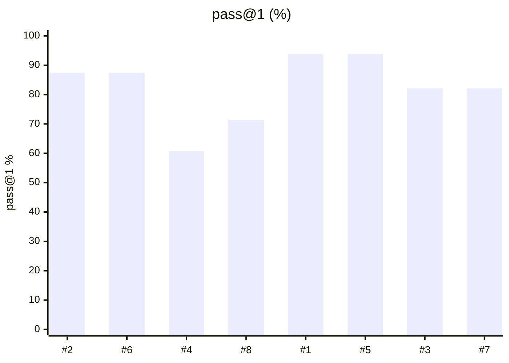
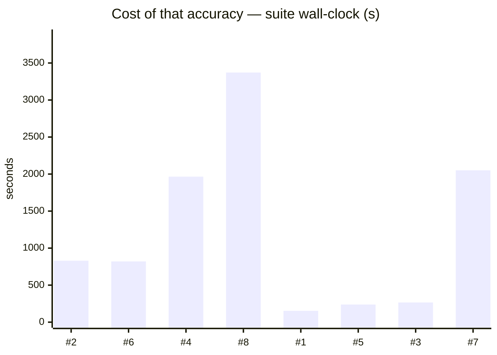
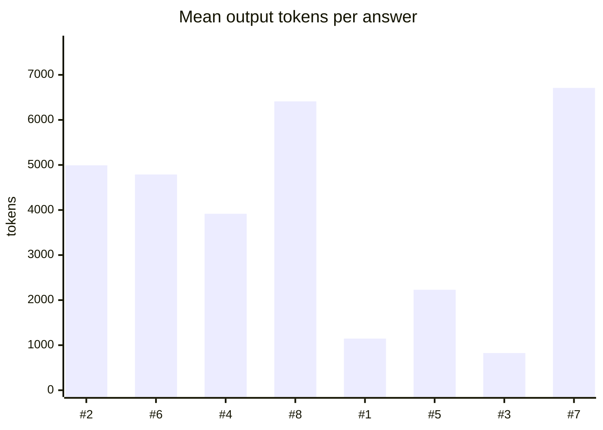

# LFM2.5-24B-A2B (FP8) vs Qwen3.6-35B-A3B (NVFP4)

**Question.** Should LFM2.5-24B-A2B replace Qwen3.6-35B-A3B as the main model on the DGX Spark?

**Verdict.** No — keep Qwen3.6-35B-A3B. LFM2.5 trails on every arm (one-shot think-ON 71.4 vs 82.1, agentic-hard 87.5 vs 93.8), uses 2-4x the output tokens on agentic tasks, makes more invalid tool calls (77-81% vs 96%) and decodes ~40% slower on this box. Only the budget-bound think-OFF one-shot gap (60.7 vs 82.1; LFM2.5 cannot disable thinking) clears its 95% CI; the others are within noise, but it wins nothing. Re-test when an NVFP4 checkpoint or the DSpark drafter lands, and through pi/opencode, which it was RL-trained in.

## Setup

| | |
|---|---|
| Endpoint | `http://localhost:8001` |
| Tasks | mixed — 8 (montimage-dgx-sp OFF 1), 8 (montimage-dgx-sp ON 1), 28 (montimage-dgx-sp OFF 2), 28 (montimage-dgx-sp ON 2), 8 (montimage-dgx-sp OFF 3), 8 (montimage-dgx-sp ON 3), 28 (montimage-dgx-sp OFF 4), 28 (montimage-dgx-sp ON 4) |
| Samples per task | 2 (⇒ mixed — 16 (montimage-dgx-sp OFF 1), 16 (montimage-dgx-sp ON 1), 56 (montimage-dgx-sp OFF 2), 56 (montimage-dgx-sp ON 2), 16 (montimage-dgx-sp OFF 3), 16 (montimage-dgx-sp ON 3), 56 (montimage-dgx-sp OFF 4), 56 (montimage-dgx-sp ON 4) generations per run) |
| Concurrency | 4 |
| Metric | pass@1 over hidden executable unit tests, with a 95% Wilson interval |

## Headline

| Run | pass@1 (95% CI) | Tokens per task | Time per task |
|---|---|---|---|---|
| lfm2.5-24b-a2b-fp8 agentic-OFF | 87.5 % (64–97) | 48,675 in / 4,993 out | 184.1 s |
| lfm2.5-24b-a2b-fp8 agentic-ON | 87.5 % (64–97) | 17,058 in / 4,789 out | 164.1 s |
| lfm2.5-24b-a2b-fp8 think-OFF | 60.7 % (48–72) | 138 in / 3,917 out | 139.5 s |
| lfm2.5-24b-a2b-fp8 think-ON | 71.4 % (59–82) | 138 in / 6,412 out | 228.8 s |
| qwen3.6-35b-a3b agentic-OFF | 93.8 % (72–99) | 22,262 in / 1,146 out | 35.2 s |
| qwen3.6-35b-a3b agentic-ON | 93.8 % (72–99) | 13,298 in / 2,230 out | 54.1 s |
| qwen3.6-35b-a3b think-OFF | 82.1 % (70–90) | 138 in / 826 out | 17.3 s |
| qwen3.6-35b-a3b think-ON | 82.1 % (70–90) | 136 in / 6,711 out | 142.6 s |

<sub>The bracket is the 95% Wilson interval of the solve rate, in points. *Tokens* and *time* are the mean per task attempt (input and output tokens as the endpoint or harness reported them; wall-clock seconds).</sub>

## At a glance

| # | Run | Harness · thinking | pass@1 | Tokens / task | Time / task |
|---|---|---|---|---|---|
| 1 | qwen3.6-35b-a3b agentic-OFF | built-in loop · OFF | `█████████▍` 94 % <sub>(72–99)</sub> | `████▍░░░░░` 23k | `█▌░░░░░░░░` 35 s |
| 2 | lfm2.5-24b-a2b-fp8 agentic-OFF | built-in loop · OFF | `████████▊░` 88 % <sub>(64–97)</sub> | `██████████` 54k | `████████░░` 184 s |
| 3 | qwen3.6-35b-a3b think-OFF | built-in loop · OFF | `████████▎░` 82 % <sub>(70–90)</sub> | `▏░░░░░░░░░` 964 | `▊░░░░░░░░░` 17 s |
| 4 | lfm2.5-24b-a2b-fp8 think-OFF | built-in loop · OFF | `██████▏░░░` 61 % <sub>(48–72)</sub> | `▊░░░░░░░░░` 4.1k | `██████▏░░░` 140 s |
| 5 | qwen3.6-35b-a3b agentic-ON | built-in loop · ON | `█████████▍` 94 % <sub>(72–99)</sub> | `██▉░░░░░░░` 16k | `██▍░░░░░░░` 54 s |
| 6 | lfm2.5-24b-a2b-fp8 agentic-ON | built-in loop · ON | `████████▊░` 88 % <sub>(64–97)</sub> | `████▏░░░░░` 22k | `███████▏░░` 164 s |
| 7 | qwen3.6-35b-a3b think-ON | built-in loop · ON | `████████▎░` 82 % <sub>(70–90)</sub> | `█▎░░░░░░░░` 6.8k | `██████▎░░░` 143 s |
| 8 | lfm2.5-24b-a2b-fp8 think-ON | built-in loop · ON | `███████▏░░` 71 % <sub>(59–82)</sub> | `█▎░░░░░░░░` 6.6k | `██████████` 229 s |

<sub>Solve-rate bars run 0–100 %, bracket = 95% interval. Token and time bars are scaled to the costliest row — shorter is cheaper. Rows are sorted only **within** one harness and thinking mode; bars from different groups are side by side, not ranked.</sub>

```mermaid
quadrantChart
    title pass@1 vs tokens per task
    x-axis Cheaper --> Costlier - max 54k tok
    y-axis Lower pass@1 --> Higher pass@1
    1: [0.44, 0.94]
    2: [0.96, 0.88]
    3: [0.04, 0.82]
    4: [0.08, 0.61]
    5: [0.29, 0.94]
    6: [0.41, 0.88]
    7: [0.13, 0.82]
    8: [0.12, 0.71]
```

```mermaid
quadrantChart
    title pass@1 vs time per task
    x-axis Cheaper --> Costlier - max 229 s
    y-axis Lower pass@1 --> Higher pass@1
    1: [0.15, 0.94]
    2: [0.80, 0.88]
    3: [0.08, 0.82]
    4: [0.61, 0.61]
    5: [0.24, 0.94]
    6: [0.72, 0.88]
    7: [0.62, 0.82]
    8: [0.96, 0.71]
```

<sub>Points are the `#` column above. Up is better, left is cheaper: the top-left corner is the most solved for the least spent. Cost is scaled to the costliest run.</sub>

## Results

| Run | pass@1 | easy | medium | hard | Wall | Mean out tok | Truncated | tok/s |
|---|---|---|---|---|---|---|---|---|
| lfm2.5-24b-a2b-fp8 agentic-OFF | 87.5 % | — | — | 87.5 % | 830 s | 4,993 | 0 | 26.9 |
| lfm2.5-24b-a2b-fp8 agentic-ON | 87.5 % | — | — | 87.5 % | 820 s | 4,789 | 0 | 28.3 |
| lfm2.5-24b-a2b-fp8 think-OFF | 60.7 % | 100.0 % | 87.5 % | 37.5 % | 1,965 s | 3,917 | 23 | 28.0 |
| lfm2.5-24b-a2b-fp8 think-ON | 71.4 % | 100.0 % | 100.0 % | 50.0 % | 3,371 s | 6,412 | 4 | 28.2 |
| qwen3.6-35b-a3b agentic-OFF | 93.8 % | — | — | 93.8 % | 153 s | 1,146 | 0 | 32.7 |
| **qwen3.6-35b-a3b agentic-ON** | **93.8 %** | — | — | 93.8 % | 238 s | 2,230 | 0 | 40.5 |
| qwen3.6-35b-a3b think-OFF | 82.1 % | 100.0 % | 93.8 % | 71.9 % | 266 s | 826 | 0 | 44.4 |
| qwen3.6-35b-a3b think-ON | 82.1 % | 100.0 % | 87.5 % | 75.0 % | 2,051 s | 6,711 | 3 | 47.0 |

<sub>Bars below are numbered as in the `#` column of *At a glance*.</sub>





```mermaid
xychart-beta
    title "Cost of that accuracy — tokens per task (in + out)"
    x-axis ["#2", "#6", "#4", "#8", "#1", "#5", "#3", "#7"]
    y-axis "tokens" 0 --> 6.172e+04
    bar [5.367e+04, 2.185e+04, 4055, 6551, 2.341e+04, 1.553e+04, 964, 6847]
```



## By difficulty

| Run | easy | medium | hard |
|---|---|---|---|
| lfm2.5-24b-a2b-fp8 agentic-OFF | — | — | `███████░` 88 % |
| lfm2.5-24b-a2b-fp8 agentic-ON | — | — | `███████░` 88 % |
| lfm2.5-24b-a2b-fp8 think-OFF | `████████` 100 % | `███████░` 88 % | `███░░░░░` 38 % |
| lfm2.5-24b-a2b-fp8 think-ON | `████████` 100 % | `████████` 100 % | `████░░░░` 50 % |
| qwen3.6-35b-a3b agentic-OFF | — | — | `███████▌` 94 % |
| qwen3.6-35b-a3b agentic-ON | — | — | `███████▌` 94 % |
| qwen3.6-35b-a3b think-OFF | `████████` 100 % | `███████▌` 94 % | `█████▊░░` 72 % |
| qwen3.6-35b-a3b think-ON | `████████` 100 % | `███████░` 88 % | `██████░░` 75 % |

## Task by task

<sub>Per-task solve rate (%). Tasks the runs disagree on are listed first, widest gap on top.</sub>

| Task | montimage-dgx-sp OFF 1 | montimage-dgx-sp ON 1 | montimage-dgx-sp OFF 2 | montimage-dgx-sp ON 2 | montimage-dgx-sp OFF 3 | montimage-dgx-sp ON 3 | montimage-dgx-sp OFF 4 | montimage-dgx-sp ON 4 |
|---|---|---|---|---|---|---|---|---|
| `bigint_div` | – | – | 🟥 0 | 🟩 100 | – | – | 🟨 50 | 🟨 50 |
| `expr_eval` | – | – | 🟥 0 | 🟨 50 | – | – | 🟩 100 | 🟩 100 |
| `running_median` | – | – | 🟥 0 | 🟩 100 | – | – | 🟨 50 | 🟩 100 |
| `tx_dict` | – | – | 🟥 0 | 🟥 0 | – | – | 🟥 0 | 🟩 100 |
| `unify` | – | – | 🟥 0 | 🟥 0 | – | – | 🟨 50 | 🟩 100 |
| `wrap_min_raggedness` | – | – | 🟥 0 | 🟨 50 | – | – | 🟩 100 | 🟩 100 |
| `cron_next` | – | – | 🟥 0 | 🟥 0 | – | – | 🟨 50 | 🟥 0 |
| `diff_lines` | – | – | 🟥 0 | 🟥 0 | – | – | 🟨 50 | 🟨 50 |
| `generalise_migration` | 🟩 100 | 🟨 50 | – | – | 🟩 100 | 🟩 100 | – | – |
| `hidden_spec_compliance` | 🟩 100 | 🟨 50 | – | – | 🟩 100 | 🟨 50 | – | – |
| `json5_parse` | – | – | 🟥 0 | 🟥 0 | – | – | 🟨 50 | 🟥 0 |
| `lru_cache` | – | – | 🟩 100 | 🟩 100 | – | – | 🟩 100 | 🟨 50 |
| `perf_budget` | 🟨 50 | 🟩 100 | – | – | 🟨 50 | 🟩 100 | – | – |
| `range_module` | – | – | 🟨 50 | 🟨 50 | – | – | 🟩 100 | 🟩 100 |
| `retry_decorator` | – | – | 🟩 100 | 🟩 100 | – | – | 🟩 100 | 🟨 50 |
| `topo_batches` | – | – | 🟨 50 | 🟨 50 | – | – | 🟩 100 | 🟩 100 |
| `wrong_test_not_code` | 🟨 50 | 🟩 100 | – | – | 🟩 100 | 🟩 100 | – | – |
| `api_migration` | 🟩 100 | 🟩 100 | – | – | 🟩 100 | 🟩 100 | – | – |
| `balanced` | – | – | 🟩 100 | 🟩 100 | – | – | 🟩 100 | 🟩 100 |
| `cascading_failures` | 🟩 100 | 🟩 100 | – | – | 🟩 100 | 🟩 100 | – | – |
| `conflicting_docs` | 🟩 100 | 🟩 100 | – | – | 🟩 100 | 🟩 100 | – | – |
| `decoy_bug` | 🟩 100 | 🟩 100 | – | – | 🟩 100 | 🟩 100 | – | – |
| `edit_distance` | – | – | 🟩 100 | 🟩 100 | – | – | 🟩 100 | 🟩 100 |
| `flatten_json` | – | – | 🟩 100 | 🟩 100 | – | – | 🟩 100 | 🟩 100 |
| `merge_intervals` | – | – | 🟩 100 | 🟩 100 | – | – | 🟩 100 | 🟩 100 |
| `rate_limiter` | – | – | 🟩 100 | 🟩 100 | – | – | 🟩 100 | 🟩 100 |
| `regex_match` | – | – | 🟩 100 | 🟩 100 | – | – | 🟩 100 | 🟩 100 |
| `roman` | – | – | 🟩 100 | 🟩 100 | – | – | 🟩 100 | 🟩 100 |
| `sql_parse` | – | – | 🟩 100 | 🟩 100 | – | – | 🟩 100 | 🟩 100 |
| `sql_select` | – | – | 🟥 0 | 🟥 0 | – | – | 🟥 0 | 🟥 0 |
| `topo_sort` | – | – | 🟩 100 | 🟩 100 | – | – | 🟩 100 | 🟩 100 |
| `two_sum` | – | – | 🟩 100 | 🟩 100 | – | – | 🟩 100 | 🟩 100 |
| `version_cmp` | – | – | 🟩 100 | 🟩 100 | – | – | 🟩 100 | 🟩 100 |
| `weighted_intervals` | – | – | 🟩 100 | 🟩 100 | – | – | 🟩 100 | 🟩 100 |
| `word_freq` | – | – | 🟩 100 | 🟩 100 | – | – | 🟩 100 | 🟩 100 |
| `word_ladder` | – | – | 🟩 100 | 🟩 100 | – | – | 🟩 100 | 🟩 100 |

## Where they disagree — qwen3.6-35b-a3b agentic-ON vs qwen3.6-35b-a3b agentic-OFF

| Task | qwen3.6-35b-a3b agentic-ON | qwen3.6-35b-a3b agentic-OFF | Winner |
|---|---|---|---|
| `hidden_spec_compliance` | 50 % | 100 % | qwen3.6-35b-a3b agentic-OFF |
| `perf_budget` | 100 % | 50 % | qwen3.6-35b-a3b agentic-ON |

## Cost per task

<sub>Mean per attempt: input / output tokens, then wall-clock seconds. *not reported* = no usage reported for that task; *–* = the run has no cost record for it.</sub>

| Task | lfm2.5-24b-a2b-fp8 agentic-OFF | lfm2.5-24b-a2b-fp8 agentic-ON | lfm2.5-24b-a2b-fp8 think-OFF | lfm2.5-24b-a2b-fp8 think-ON | qwen3.6-35b-a3b agentic-OFF | qwen3.6-35b-a3b agentic-ON | qwen3.6-35b-a3b think-OFF | qwen3.6-35b-a3b think-ON |
|---|---|---|---|---|---|---|---|---|
| `api_migration` | 10,964 / 1,758 · 66.4 s | 7,655 / 1,580 · 59.5 s | – | – | 21,947 / 1,002 · 32.9 s | 21,062 / 1,513 · 38.5 s | – | – |
| `balanced` | – | – | 99 / 919 · 32.6 s | 99 / 884 · 31.1 s | – | – | 98 / 110 · 3.6 s | 96 / 826 · 17.3 s |
| `bigint_div` | – | – | 155 / 6,000 · 215.3 s | 155 / 6,224 · 227.4 s | – | – | 156 / 1,349 · 28.5 s | 154 / 8,185 · 175.5 s |
| `cascading_failures` | 12,780 / 1,966 · 73.3 s | 8,350 / 2,224 · 82.5 s | – | – | 10,981 / 677 · 20.2 s | 7,170 / 1,090 · 26.2 s | – | – |
| `conflicting_docs` | 29,022 / 4,015 · 153.0 s | 9,554 / 3,128 · 117.5 s | – | – | 10,708 / 770 · 23.8 s | 12,196 / 1,759 · 45.5 s | – | – |
| `cron_next` | – | – | 193 / 6,000 · 213.9 s | 193 / 11,948 · 435.7 s | – | – | 189 / 1,722 · 36.3 s | 187 / 11,675 · 249.2 s |
| `decoy_bug` | 9,171 / 1,251 · 47.2 s | 5,179 / 1,009 · 37.8 s | – | – | 7,511 / 405 · 11.2 s | 6,619 / 935 · 22.1 s | – | – |
| `diff_lines` | – | – | 137 / 6,000 · 214.5 s | 137 / 5,505 · 198.3 s | – | – | 139 / 548 · 11.1 s | 137 / 8,378 · 181.0 s |
| `edit_distance` | – | – | 82 / 1,274 · 44.8 s | 82 / 1,285 · 44.7 s | – | – | 84 / 262 · 5.8 s | 82 / 1,454 · 30.3 s |
| `expr_eval` | – | – | 110 / 6,000 · 213.7 s | 110 / 12,976 · 468.3 s | – | – | 107 / 996 · 20.5 s | 105 / 10,333 · 218.3 s |
| `flatten_json` | – | – | 118 / 3,700 · 131.2 s | 118 / 3,092 · 108.3 s | – | – | 113 / 258 · 5.8 s | 111 / 4,633 · 99.6 s |
| `generalise_migration` | 78,582 / 7,534 · 276.0 s | 33,860 / 4,074 · 156.2 s | – | – | 13,933 / 890 · 26.8 s | 22,783 / 1,415 · 38.1 s | – | – |
| `hidden_spec_compliance` | 114,768 / 9,245 · 351.1 s | 38,562 / 11,459 · 425.9 s | – | – | 49,048 / 2,992 · 87.4 s | 9,818 / 7,142 · 166.4 s | – | – |
| `json5_parse` | – | – | 189 / 6,000 · 214.2 s | 189 / 15,603 · 566.7 s | – | – | 182 / 2,392 · 47.1 s | 180 / 13,662 · 284.6 s |
| `lru_cache` | – | – | 125 / 2,578 · 90.8 s | 125 / 2,635 · 92.3 s | – | – | 128 / 495 · 11.2 s | 126 / 10,018 · 201.7 s |
| `merge_intervals` | – | – | 92 / 1,424 · 50.1 s | 92 / 1,373 · 47.7 s | – | – | 88 / 158 · 3.8 s | 86 / 1,629 · 34.1 s |
| `perf_budget` | 90,112 / 6,126 · 238.5 s | 24,631 / 5,567 · 208.8 s | – | – | 14,439 / 1,189 · 37.0 s | 9,662 / 1,747 · 47.8 s | – | – |
| `range_module` | – | – | 133 / 6,000 · 213.6 s | 133 / 10,488 · 385.4 s | – | – | 134 / 1,537 · 34.4 s | 132 / 11,378 · 244.9 s |
| `rate_limiter` | – | – | 146 / 2,794 · 99.7 s | 146 / 2,500 · 92.0 s | – | – | 146 / 241 · 5.6 s | 144 / 3,384 · 75.6 s |
| `regex_match` | – | – | 121 / 4,928 · 176.8 s | 121 / 4,224 · 152.5 s | – | – | 121 / 448 · 9.4 s | 119 / 5,793 · 119.4 s |
| `retry_decorator` | – | – | 121 / 2,208 · 78.4 s | 121 / 2,304 · 81.0 s | – | – | 120 / 142 · 3.3 s | 118 / 8,850 · 184.6 s |
| `roman` | – | – | 84 / 1,251 · 48.4 s | 84 / 1,260 · 43.7 s | – | – | 88 / 238 · 8.7 s | 86 / 1,176 · 24.2 s |
| `running_median` | – | – | 159 / 6,000 · 205.6 s | 159 / 13,108 · 383.2 s | – | – | 165 / 1,596 · 33.6 s | 163 / 11,941 · 254.7 s |
| `sql_parse` | – | – | 131 / 2,960 · 104.8 s | 131 / 3,238 · 114.3 s | – | – | 132 / 502 · 10.9 s | 130 / 5,252 · 117.8 s |
| `sql_select` | – | – | 218 / 6,000 · 212.1 s | 218 / 15,418 · 558.2 s | – | – | 213 / 4,141 · 70.8 s | 211 / 14,904 · 308.8 s |
| `topo_batches` | – | – | 168 / 5,517 · 195.3 s | 168 / 6,676 · 240.9 s | – | – | 158 / 510 · 11.0 s | 156 / 5,522 · 116.7 s |
| `topo_sort` | – | – | 121 / 2,732 · 96.7 s | 121 / 2,301 · 81.8 s | – | – | 123 / 320 · 6.5 s | 121 / 3,962 · 86.0 s |
| `two_sum` | – | – | 113 / 1,376 · 52.7 s | 113 / 1,468 · 51.0 s | – | – | 116 / 70 · 4.0 s | 114 / 919 · 19.6 s |
| `tx_dict` | – | – | 192 / 6,000 · 215.1 s | 192 / 13,026 · 470.0 s | – | – | 193 / 840 · 18.3 s | 191 / 8,622 · 188.2 s |
| `unify` | – | – | 202 / 6,000 · 213.4 s | 202 / 16,000 · 589.7 s | – | – | 202 / 1,115 · 24.1 s | 200 / 11,738 · 248.6 s |
| `version_cmp` | – | – | 106 / 1,458 · 51.8 s | 106 / 1,818 · 64.1 s | – | – | 107 / 198 · 4.3 s | 105 / 1,839 · 39.0 s |
| `weighted_intervals` | – | – | 148 / 3,702 · 135.2 s | 148 / 3,294 · 117.6 s | – | – | 149 / 476 · 10.4 s | 147 / 5,004 · 106.7 s |
| `word_freq` | – | – | 122 / 2,010 · 71.0 s | 122 / 2,206 · 77.8 s | – | – | 124 / 140 · 3.1 s | 122 / 1,955 · 41.3 s |
| `word_ladder` | – | – | 136 / 2,850 · 100.7 s | 136 / 3,814 · 135.6 s | – | – | 136 / 328 · 7.0 s | 134 / 3,930 · 85.4 s |
| `wrap_min_raggedness` | – | – | 151 / 6,000 · 213.5 s | 151 / 14,874 · 548.2 s | – | – | 153 / 1,994 · 44.7 s | 151 / 10,950 · 239.1 s |
| `wrong_test_not_code` | 44,000 / 8,048 · 267.2 s | 8,670 / 9,271 · 224.2 s | – | – | 49,532 / 1,240 · 42.5 s | 17,076 / 2,242 · 48.1 s | – | – |

## Reading the numbers

## Analysis

**Harness:** benchkit's built-in loop for every row. Same endpoint (`:8001` router, alias
`montimage-dgx-spark`), same 0.62 / 32 GiB-KV memory pin, 2 samples per task.
Incumbent: `configs/qwen3.6-35b-a3b-nvfp4.sh` (live launcher). Candidate:
`configs/lfm2.5-24b-a2b-fp8.sh` — official `LiquidAI/LFM2.5-24B-A2B-FP8` checkpoint,
`--reasoning-parser qwen3 --tool-call-parser lfm2`, model-card sampling
(temp 0.1, top_k 50, repetition_penalty 1.05), no speculative decoding (no MTP head).

| Arm | Qwen3.6-35B-A3B NVFP4 | LFM2.5-24B-A2B FP8 |
|---|---|---|
| `all` think-OFF (6k budget) | **82.1 %** (70.2–90.0), 826 out-tok, 0 trunc | 60.7 % (47.6–72.4), 3,917 out-tok, **23 trunc** |
| `all` think-ON (16k budget) | **82.1 %**, 6,711 out-tok, 3 trunc | 71.4 % (58.5–81.6), 6,412 out-tok, 4 trunc |
| `agentic-hard` OFF | **93.8 %** (71.7–98.9), 1,146 out-tok, valid calls 96 % | 87.5 % (64.0–96.5), 4,993 out-tok, valid calls 81 % |
| `agentic-hard` ON | **93.8 %**, 2,230 out-tok, valid calls 96 % | 87.5 %, 4,789 out-tok, valid calls 77 %, 2 turn-limit hits |
| Decode speed (per stream, conc. 4) | 44–47 tok/s (MTP k=2) | 27–28 tok/s |

**Caveats.**

- **LFM2.5 has no think-OFF mode.** Its chat template opens `<think>` on every
  assistant turn and ignores `enable_thinking`, so the OFF arms measure the same
  always-reasoning model under a 6k budget. The 23 truncations there are the budget,
  not the model's code — this −21.4 pp margin *does* clear its Newcombe interval
  (lower bound ≈ +4.7 pp), but it is a budget effect: a client that caps output at 6k
  will see exactly this. The fair one-shot comparison is the ON arm: −10.7 pp, and the
  95 % intervals overlap, so this margin alone is not decisive at n=56.
- **Agentic margins are noise** (−6.3 pp, n=16 each, intervals overlap almost entirely).
- **Speed is a serving-stack number, not a model ceiling.** vLLM picked DeepGEMM FP8
  block kernels on GB10 with no FlashInfer autotune cache; no NVFP4 checkpoint and no
  MTP drafter exist yet (Liquid lists a DSpark drafter as "coming soon", SGLang only).
- **"Stalled" = finished by plain text instead of the `finish` tool** (15/16 OFF, 6/16 ON
  for LFM2.5 vs 0/16 and 3/16 for Qwen). It is not a failure by itself but means the
  model ignores the loop's explicit finish protocol more often.
- Liquid states the model was RL-trained inside pi and OpenCode. A harness run
  (AGENTS.md step 6) could narrow the agentic gap; it was not run here.

## Verdict reasoning

Every arm points the same way: LFM2.5 scores lower (−10.7 pp one-shot ON, −6.3 pp
agentic), emits 2–4× more output tokens per agentic task, decodes ~40 % slower per
stream on this box, and makes more invalid tool calls (77–81 % vs 96 %). Only the
budget-bound think-OFF one-shot margin clears its confidence interval, but there is no arm where it wins on solve rate,
cost or reliability, and its only theoretical advantage — fewer active parameters —
does not show up as speed on this stack today.

## Caveats

- 2 samples per task. Every solve rate carries a 95% Wilson interval over the generations behind it, and a margin between two runs is only a result when the 95% Newcombe interval of the difference excludes zero. The intervals treat each generation as independent; samples of one task are correlated, so with few tasks the true uncertainty is if anything wider. Raise `--samples` before calling a close race.
- Single-turn Python code generation only. Multi-turn agentic tool use is not exercised here.
- A truncated generation counts as a failure; a high `Truncated` column means runaway reasoning, which hangs real agents.

## Raw data

- `lfm2.5-24b-a2b-fp8-agentic-off.json` — lfm2.5-24b-a2b-fp8 agentic-OFF
- `lfm2.5-24b-a2b-fp8-agentic-on.json` — lfm2.5-24b-a2b-fp8 agentic-ON
- `lfm2.5-24b-a2b-fp8-all-off.json` — lfm2.5-24b-a2b-fp8 think-OFF
- `lfm2.5-24b-a2b-fp8-all-on.json` — lfm2.5-24b-a2b-fp8 think-ON
- `qwen3.6-35b-a3b-agentic-off.json` — qwen3.6-35b-a3b agentic-OFF
- `qwen3.6-35b-a3b-agentic-on.json` — qwen3.6-35b-a3b agentic-ON
- `qwen3.6-35b-a3b-all-off.json` — qwen3.6-35b-a3b think-OFF
- `qwen3.6-35b-a3b-all-on.json` — qwen3.6-35b-a3b think-ON
