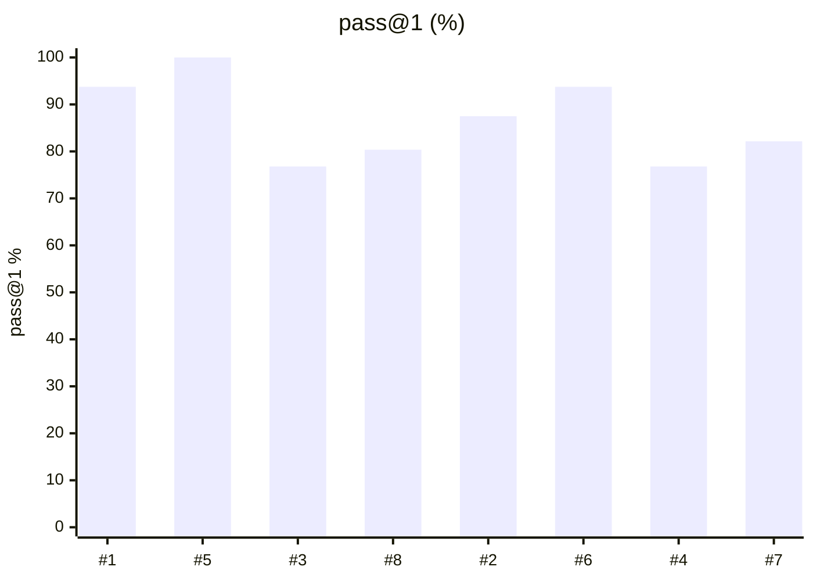
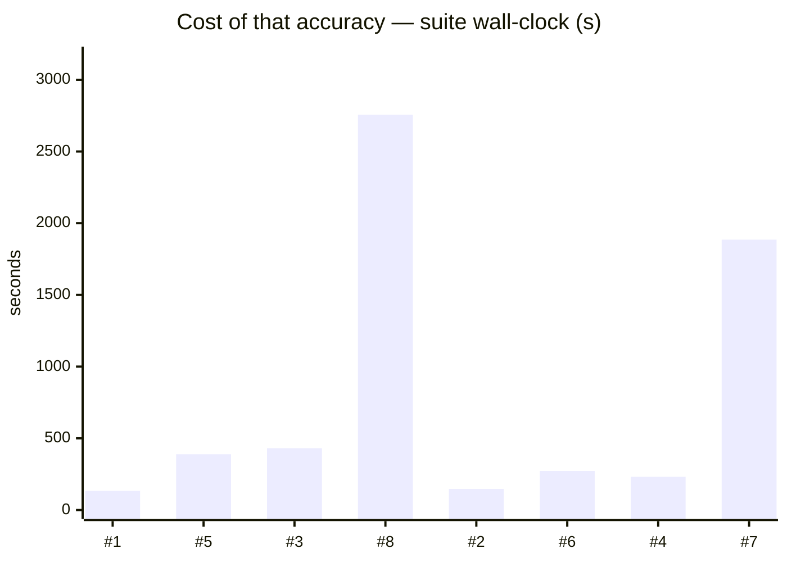
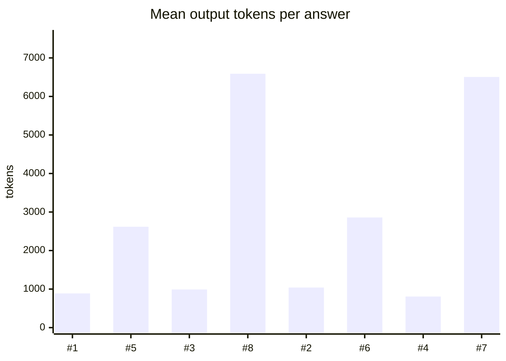

# llama.cpp 1.0 (CUDA, Q4_K_M) vs vLLM (NVFP4) on montimage-dgx-spark

**Question.** Should llama.cpp 1.0 replace vLLM as the serving backend for montimage-dgx-spark on this DGX Spark?

**Verdict.** Keep vLLM. No solve-rate margin has a 95% interval that excludes zero: all think-OFF is an exact tie at 76.8%, all think-ON favours vLLM by 1.7 pp, and the two agentic-hard arms favour llama.cpp by 6.3 pp and 6.2 pp with heavily overlapping intervals at n=16. The only clear signal is speed — vLLM is 1.8x faster per task on all OFF and 1.47x faster on all ON at essentially identical output-token counts, with a ~50 vs ~35 tok/s decode rate. llama.cpp's mild efficiency edge on agentic arms and its nominal 100% on agentic ON do not outweigh that. Revisit only with matched NVFP4 weights and at least 8 samples to narrow the intervals; also note the candidate could not coexist with vLLM on this box and required an endpoint swap.

## Setup

| | |
|---|---|
| Endpoint | `http://127.0.0.1:8801` |
| Tasks | mixed — 8 (montimage-dgx-sp OFF 1), 8 (montimage-dgx-sp ON 1), 28 (montimage-dgx-sp OFF 2), 28 (montimage-dgx-sp ON 2), 8 (montimage-dgx-sp OFF 3), 8 (montimage-dgx-sp ON 3), 28 (montimage-dgx-sp OFF 4), 28 (montimage-dgx-sp ON 4) |
| Samples per task | 2 (⇒ mixed — 16 (montimage-dgx-sp OFF 1), 16 (montimage-dgx-sp ON 1), 56 (montimage-dgx-sp OFF 2), 56 (montimage-dgx-sp ON 2), 16 (montimage-dgx-sp OFF 3), 16 (montimage-dgx-sp ON 3), 56 (montimage-dgx-sp OFF 4), 56 (montimage-dgx-sp ON 4) generations per run) |
| Concurrency | 4 |
| Metric | pass@1 over hidden executable unit tests, with a 95% Wilson interval |

## Headline

| Run | pass@1 (95% CI) | Tokens per task | Time per task |
|---|---|---|---|---|
| llamacpp1-agentic-off | 93.8 % (72–99) | 12,760 in / 888 out | 31.0 s |
| llamacpp1-agentic-on | 100.0 % (81–100) | 10,914 in / 2,617 out | 75.8 s |
| llamacpp1-all-off | 76.8 % (64–86) | 138 in / 990 out | 27.8 s |
| llamacpp1-all-on | 80.4 % (68–89) | 136 in / 6,589 out | 194.2 s |
| vllm-agentic-off | 87.5 % (64–97) | 17,412 in / 1,040 out | 32.6 s |
| vllm-agentic-on | 93.8 % (72–99) | 12,538 in / 2,859 out | 65.7 s |
| vllm-all-off | 76.8 % (64–86) | 138 in / 806 out | 15.4 s |
| vllm-all-on | 82.1 % (70–90) | 136 in / 6,506 out | 132.0 s |

<sub>The bracket is the 95% Wilson interval of the solve rate, in points. *Tokens* and *time* are the mean per task attempt (input and output tokens as the endpoint or harness reported them; wall-clock seconds).</sub>

## At a glance

| # | Run | Harness · thinking | pass@1 | Tokens / task | Time / task |
|---|---|---|---|---|---|
| 1 | llamacpp1-agentic-off | built-in loop · OFF | `█████████▍` 94 % <sub>(72–99)</sub> | `███████▍░░` 14k | `█▋░░░░░░░░` 31 s |
| 2 | vllm-agentic-off | built-in loop · OFF | `████████▊░` 88 % <sub>(64–97)</sub> | `██████████` 18k | `█▋░░░░░░░░` 33 s |
| 3 | llamacpp1-all-off | built-in loop · OFF | `███████▋░░` 77 % <sub>(64–86)</sub> | `▋░░░░░░░░░` 1.1k | `█▍░░░░░░░░` 28 s |
| 4 | vllm-all-off | built-in loop · OFF | `███████▋░░` 77 % <sub>(64–86)</sub> | `▌░░░░░░░░░` 944 | `▊░░░░░░░░░` 15 s |
| 5 | llamacpp1-agentic-on | built-in loop · ON | `██████████` 100 % <sub>(81–100)</sub> | `███████▍░░` 14k | `███▉░░░░░░` 76 s |
| 6 | vllm-agentic-on | built-in loop · ON | `█████████▍` 94 % <sub>(72–99)</sub> | `████████▍░` 15k | `███▍░░░░░░` 66 s |
| 7 | vllm-all-on | built-in loop · ON | `████████▎░` 82 % <sub>(70–90)</sub> | `███▋░░░░░░` 6.6k | `██████▊░░░` 132 s |
| 8 | llamacpp1-all-on | built-in loop · ON | `████████░░` 80 % <sub>(68–89)</sub> | `███▋░░░░░░` 6.7k | `██████████` 194 s |

<sub>Solve-rate bars run 0–100 %, bracket = 95% interval. Token and time bars are scaled to the costliest row — shorter is cheaper. Rows are sorted only **within** one harness and thinking mode; bars from different groups are side by side, not ranked.</sub>

```mermaid
quadrantChart
    title pass@1 vs tokens per task
    x-axis Cheaper --> Costlier - max 18k tok
    y-axis Lower pass@1 --> Higher pass@1
    1: [0.74, 0.94]
    2: [0.96, 0.88]
    3: [0.06, 0.77]
    4: [0.05, 0.77]
    5: [0.73, 0.96]
    6: [0.83, 0.94]
    7: [0.36, 0.82]
    8: [0.36, 0.80]
```

```mermaid
quadrantChart
    title pass@1 vs time per task
    x-axis Cheaper --> Costlier - max 194 s
    y-axis Lower pass@1 --> Higher pass@1
    1: [0.16, 0.94]
    2: [0.17, 0.88]
    3: [0.14, 0.77]
    4: [0.08, 0.77]
    5: [0.39, 0.96]
    6: [0.34, 0.94]
    7: [0.68, 0.82]
    8: [0.96, 0.80]
```

<sub>Points are the `#` column above. Up is better, left is cheaper: the top-left corner is the most solved for the least spent. Cost is scaled to the costliest run.</sub>

## Results

| Run | pass@1 | easy | medium | hard | Wall | Mean out tok | Truncated | tok/s |
|---|---|---|---|---|---|---|---|---|
| llamacpp1-agentic-off | 93.8 % | — | — | 93.8 % | 134 s | 888 | 0 | 28.6 |
| **llamacpp1-agentic-on** | **100.0 %** | — | — | 100.0 % | 389 s | 2,617 | 0 | 32.4 |
| llamacpp1-all-off | 76.8 % | 100.0 % | 87.5 % | 65.6 % | 431 s | 990 | 1 | 34.3 |
| llamacpp1-all-on | 80.4 % | 100.0 % | 93.8 % | 68.8 % | 2,756 s | 6,589 | 1 | 34.3 |
| vllm-agentic-off | 87.5 % | — | — | 87.5 % | 147 s | 1,040 | 0 | 34.9 |
| vllm-agentic-on | 93.8 % | — | — | 93.8 % | 272 s | 2,859 | 0 | 43.3 |
| vllm-all-off | 76.8 % | 100.0 % | 87.5 % | 65.6 % | 231 s | 806 | 0 | 51.1 |
| vllm-all-on | 82.1 % | 100.0 % | 87.5 % | 75.0 % | 1,885 s | 6,506 | 3 | 49.0 |

<sub>Bars below are numbered as in the `#` column of *At a glance*.</sub>





```mermaid
xychart-beta
    title "Cost of that accuracy — tokens per task (in + out)"
    x-axis ["#1", "#5", "#3", "#8", "#2", "#6", "#4", "#7"]
    y-axis "tokens" 0 --> 2.122e+04
    bar [1.365e+04, 1.353e+04, 1128, 6725, 1.845e+04, 1.54e+04, 944.3, 6642]
```



## By difficulty

| Run | easy | medium | hard |
|---|---|---|---|
| llamacpp1-agentic-off | — | — | `███████▌` 94 % |
| llamacpp1-agentic-on | — | — | `████████` 100 % |
| llamacpp1-all-off | `████████` 100 % | `███████░` 88 % | `█████▎░░` 66 % |
| llamacpp1-all-on | `████████` 100 % | `███████▌` 94 % | `█████▌░░` 69 % |
| vllm-agentic-off | — | — | `███████░` 88 % |
| vllm-agentic-on | — | — | `███████▌` 94 % |
| vllm-all-off | `████████` 100 % | `███████░` 88 % | `█████▎░░` 66 % |
| vllm-all-on | `████████` 100 % | `███████░` 88 % | `██████░░` 75 % |

## Task by task

<sub>Per-task solve rate (%). Tasks the runs disagree on are listed first, widest gap on top.</sub>

| Task | montimage-dgx-sp OFF 1 | montimage-dgx-sp ON 1 | montimage-dgx-sp OFF 2 | montimage-dgx-sp ON 2 | montimage-dgx-sp OFF 3 | montimage-dgx-sp ON 3 | montimage-dgx-sp OFF 4 | montimage-dgx-sp ON 4 |
|---|---|---|---|---|---|---|---|---|
| `cron_next` | – | – | 🟥 0 | 🟥 0 | – | – | 🟥 0 | 🟩 100 |
| `hidden_spec_compliance` | 🟨 50 | 🟩 100 | – | – | 🟥 0 | 🟨 50 | – | – |
| `tx_dict` | – | – | 🟥 0 | 🟩 100 | – | – | 🟨 50 | 🟨 50 |
| `bigint_div` | – | – | 🟩 100 | 🟨 50 | – | – | 🟨 50 | 🟩 100 |
| `diff_lines` | – | – | 🟩 100 | 🟩 100 | – | – | 🟨 50 | 🟩 100 |
| `expr_eval` | – | – | 🟩 100 | 🟩 100 | – | – | 🟩 100 | 🟨 50 |
| `json5_parse` | – | – | 🟨 50 | 🟥 0 | – | – | 🟨 50 | 🟥 0 |
| `lru_cache` | – | – | 🟩 100 | 🟩 100 | – | – | 🟩 100 | 🟨 50 |
| `range_module` | – | – | 🟨 50 | 🟥 0 | – | – | 🟨 50 | 🟨 50 |
| `running_median` | – | – | 🟥 0 | 🟨 50 | – | – | 🟥 0 | 🟨 50 |
| `word_ladder` | – | – | 🟨 50 | 🟩 100 | – | – | 🟩 100 | 🟩 100 |
| `wrap_min_raggedness` | – | – | 🟨 50 | 🟩 100 | – | – | 🟨 50 | 🟩 100 |
| `api_migration` | 🟩 100 | 🟩 100 | – | – | 🟩 100 | 🟩 100 | – | – |
| `balanced` | – | – | 🟩 100 | 🟩 100 | – | – | 🟩 100 | 🟩 100 |
| `cascading_failures` | 🟩 100 | 🟩 100 | – | – | 🟩 100 | 🟩 100 | – | – |
| `conflicting_docs` | 🟩 100 | 🟩 100 | – | – | 🟩 100 | 🟩 100 | – | – |
| `decoy_bug` | 🟩 100 | 🟩 100 | – | – | 🟩 100 | 🟩 100 | – | – |
| `edit_distance` | – | – | 🟩 100 | 🟩 100 | – | – | 🟩 100 | 🟩 100 |
| `flatten_json` | – | – | 🟩 100 | 🟩 100 | – | – | 🟩 100 | 🟩 100 |
| `generalise_migration` | 🟩 100 | 🟩 100 | – | – | 🟩 100 | 🟩 100 | – | – |
| `merge_intervals` | – | – | 🟩 100 | 🟩 100 | – | – | 🟩 100 | 🟩 100 |
| `perf_budget` | 🟩 100 | 🟩 100 | – | – | 🟩 100 | 🟩 100 | – | – |
| `rate_limiter` | – | – | 🟩 100 | 🟩 100 | – | – | 🟩 100 | 🟩 100 |
| `regex_match` | – | – | 🟩 100 | 🟩 100 | – | – | 🟩 100 | 🟩 100 |
| `retry_decorator` | – | – | 🟩 100 | 🟩 100 | – | – | 🟩 100 | 🟩 100 |
| `roman` | – | – | 🟩 100 | 🟩 100 | – | – | 🟩 100 | 🟩 100 |
| `sql_parse` | – | – | 🟩 100 | 🟩 100 | – | – | 🟩 100 | 🟩 100 |
| `sql_select` | – | – | 🟥 0 | 🟥 0 | – | – | 🟥 0 | 🟥 0 |
| `topo_batches` | – | – | 🟩 100 | 🟩 100 | – | – | 🟩 100 | 🟩 100 |
| `topo_sort` | – | – | 🟩 100 | 🟩 100 | – | – | 🟩 100 | 🟩 100 |
| `two_sum` | – | – | 🟩 100 | 🟩 100 | – | – | 🟩 100 | 🟩 100 |
| `unify` | – | – | 🟨 50 | 🟨 50 | – | – | 🟨 50 | 🟨 50 |
| `version_cmp` | – | – | 🟩 100 | 🟩 100 | – | – | 🟩 100 | 🟩 100 |
| `weighted_intervals` | – | – | 🟩 100 | 🟩 100 | – | – | 🟩 100 | 🟩 100 |
| `word_freq` | – | – | 🟩 100 | 🟩 100 | – | – | 🟩 100 | 🟩 100 |
| `wrong_test_not_code` | 🟩 100 | 🟩 100 | – | – | 🟩 100 | 🟩 100 | – | – |

## Where they disagree — llamacpp1-agentic-on vs llamacpp1-agentic-off

| Task | llamacpp1-agentic-on | llamacpp1-agentic-off | Winner |
|---|---|---|---|
| `hidden_spec_compliance` | 100 % | 50 % | llamacpp1-agentic-on |

## Cost per task

<sub>Mean per attempt: input / output tokens, then wall-clock seconds. *not reported* = no usage reported for that task; *–* = the run has no cost record for it.</sub>

| Task | llamacpp1-agentic-off | llamacpp1-agentic-on | llamacpp1-all-off | llamacpp1-all-on | vllm-agentic-off | vllm-agentic-on | vllm-all-off | vllm-all-on |
|---|---|---|---|---|---|---|---|---|
| `api_migration` | 13,089 / 856 · 29.9 s | 9,007 / 965 · 30.4 s | – | – | 9,548 / 924 · 24.7 s | 10,448 / 1,091 · 25.0 s | – | – |
| `balanced` | – | – | 98 / 116 · 3.6 s | 96 / 1,408 · 40.0 s | – | – | 98 / 116 · 2.3 s | 96 / 1,306 · 26.9 s |
| `bigint_div` | – | – | 156 / 472 · 13.2 s | 154 / 11,305 · 336.0 s | – | – | 156 / 1,736 · 33.8 s | 154 / 7,992 · 168.4 s |
| `cascading_failures` | 9,454 / 854 · 29.7 s | 7,526 / 1,135 · 35.4 s | – | – | 14,198 / 868 · 26.4 s | 10,581 / 1,210 · 29.3 s | – | – |
| `conflicting_docs` | 9,874 / 758 · 26.5 s | 6,956 / 1,196 · 38.0 s | – | – | 17,462 / 879 · 23.0 s | 11,267 / 1,754 · 42.3 s | – | – |
| `cron_next` | – | – | 189 / 1,571 · 47.1 s | 187 / 9,684 · 291.4 s | – | – | 189 / 1,634 · 31.6 s | 187 / 11,660 · 240.2 s |
| `decoy_bug` | 6,720 / 466 · 16.2 s | 7,478 / 1,098 · 34.1 s | – | – | 7,442 / 397 · 11.8 s | 7,430 / 1,090 · 25.2 s | – | – |
| `diff_lines` | – | – | 139 / 472 · 13.4 s | 137 / 6,802 · 200.1 s | – | – | 139 / 511 · 9.7 s | 137 / 7,536 · 155.5 s |
| `edit_distance` | – | – | 84 / 268 · 8.0 s | 82 / 1,696 · 48.9 s | – | – | 84 / 270 · 5.1 s | 82 / 1,326 · 26.6 s |
| `expr_eval` | – | – | 107 / 1,039 · 29.4 s | 105 / 7,976 · 231.0 s | – | – | 107 / 974 · 18.2 s | 105 / 13,039 · 259.6 s |
| `flatten_json` | – | – | 113 / 370 · 10.8 s | 111 / 4,418 · 127.2 s | – | – | 113 / 324 · 6.6 s | 111 / 3,830 · 81.3 s |
| `generalise_migration` | 19,649 / 1,122 · 40.0 s | 26,419 / 1,709 · 54.6 s | – | – | 14,234 / 787 · 20.6 s | 26,590 / 1,563 · 38.8 s | – | – |
| `hidden_spec_compliance` | 12,665 / 1,017 · 35.4 s | 12,814 / 6,262 · 194.4 s | – | – | 10,969 / 892 · 26.5 s | 11,392 / 10,658 · 241.8 s | – | – |
| `json5_parse` | – | – | 182 / 2,916 · 82.0 s | 180 / 14,529 · 435.3 s | – | – | 182 / 2,789 · 51.8 s | 180 / 14,934 · 296.7 s |
| `lru_cache` | – | – | 128 / 208 · 6.1 s | 126 / 4,522 · 129.6 s | – | – | 128 / 522 · 10.0 s | 126 / 9,514 · 184.2 s |
| `merge_intervals` | – | – | 88 / 160 · 5.0 s | 86 / 1,780 · 51.2 s | – | – | 88 / 159 · 3.1 s | 86 / 1,761 · 35.9 s |
| `perf_budget` | 15,274 / 1,135 · 39.0 s | 8,338 / 7,386 · 179.8 s | – | – | 37,170 / 2,380 · 95.7 s | 14,450 / 3,368 · 79.5 s | – | – |
| `range_module` | – | – | 134 / 1,880 · 55.8 s | 132 / 12,414 · 374.6 s | – | – | 134 / 1,082 · 22.1 s | 132 / 11,620 · 235.5 s |
| `rate_limiter` | – | – | 146 / 298 · 8.6 s | 144 / 3,280 · 96.6 s | – | – | 146 / 164 · 3.4 s | 144 / 3,236 · 70.9 s |
| `regex_match` | – | – | 121 / 430 · 12.5 s | 119 / 6,102 · 176.7 s | – | – | 121 / 462 · 8.9 s | 119 / 5,098 · 101.8 s |
| `retry_decorator` | – | – | 120 / 100 · 3.4 s | 118 / 2,297 · 65.7 s | – | – | 120 / 112 · 2.3 s | 118 / 1,955 · 40.7 s |
| `roman` | – | – | 88 / 219 · 7.3 s | 86 / 1,140 · 32.4 s | – | – | 88 / 184 · 3.7 s | 86 / 978 · 19.1 s |
| `running_median` | – | – | 165 / 3,596 · 93.5 s | 163 / 13,490 · 386.3 s | – | – | 165 / 1,684 · 31.9 s | 163 / 10,640 · 201.0 s |
| `sql_parse` | – | – | 132 / 658 · 18.8 s | 130 / 5,511 · 158.0 s | – | – | 132 / 380 · 7.4 s | 130 / 5,422 · 115.1 s |
| `sql_select` | – | – | 213 / 3,376 · 94.3 s | 211 / 14,797 · 443.9 s | – | – | 213 / 3,801 · 66.0 s | 211 / 14,208 · 286.4 s |
| `topo_batches` | – | – | 158 / 478 · 13.3 s | 156 / 7,228 · 212.1 s | – | – | 158 / 489 · 9.5 s | 156 / 5,349 · 110.2 s |
| `topo_sort` | – | – | 123 / 251 · 7.0 s | 121 / 4,796 · 137.3 s | – | – | 123 / 337 · 6.4 s | 121 / 3,852 · 80.0 s |
| `two_sum` | – | – | 116 / 72 · 2.8 s | 114 / 958 · 27.1 s | – | – | 116 / 70 · 1.5 s | 114 / 803 · 16.4 s |
| `tx_dict` | – | – | 193 / 3,730 · 102.8 s | 191 / 8,784 · 258.8 s | – | – | 193 / 823 · 16.6 s | 191 / 9,561 · 194.3 s |
| `unify` | – | – | 202 / 1,496 · 36.4 s | 200 / 10,997 · 332.4 s | – | – | 202 / 951 · 18.5 s | 200 / 9,792 · 200.2 s |
| `version_cmp` | – | – | 107 / 182 · 5.5 s | 105 / 2,704 · 77.8 s | – | – | 107 / 206 · 4.0 s | 105 / 2,472 · 50.4 s |
| `weighted_intervals` | – | – | 149 / 522 · 15.0 s | 147 / 6,504 · 189.0 s | – | – | 149 / 563 · 11.5 s | 147 / 5,886 · 121.5 s |
| `word_freq` | – | – | 124 / 238 · 7.4 s | 122 / 2,319 · 65.9 s | – | – | 124 / 194 · 3.8 s | 122 / 4,484 · 91.8 s |
| `word_ladder` | – | – | 136 / 239 · 6.9 s | 134 / 4,216 · 120.9 s | – | – | 136 / 212 · 4.1 s | 134 / 4,214 · 86.3 s |
| `wrap_min_raggedness` | – | – | 153 / 2,362 · 66.9 s | 151 / 12,837 · 390.9 s | – | – | 153 / 1,827 · 38.5 s | 151 / 9,708 · 200.1 s |
| `wrong_test_not_code` | 15,356 / 892 · 31.5 s | 8,776 / 1,182 · 39.9 s | – | – | 28,275 / 1,196 · 32.5 s | 8,146 / 2,136 · 43.9 s | – | – |

## Reading the numbers

## Setup under test

- **Engine A (incumbent):** vLLM via `ghcr.io/miaai-lab/mia-vllm-gb10-linear-b12x@sha256:1962…`, served alias `montimage-dgx-spark`, weights `unsloth/Qwen3.6-35B-A3B-NVFP4` (NVFP4). MoE/flashinfer_b12x kernels, MTP speculative decoding k=2, prefix caching on.
- **Engine B (candidate):** llama.cpp **v1.0.0** (tag `v1.0.0`, commit `b1b770d90d94cad9e9ea5b993bdbc383a522fb28`, build b12359), compiled locally from source with **CUDA** (`GGML_CUDA=ON`, `GGML_CUDA_FA=ON`, arch `121a-real`) because the Homebrew 1.0 bottle is Vulkan-only. Weights: `unsloth/Qwen3.6-35B-A3B-MTP-GGUF/Qwen3.6-35B-A3B-UD-Q4_K_M.gguf` (22 GB), served as `montimage-dgx-spark` via `--alias`.

## Results table

| Suite / mode | Engine | Solve rate | 95% CI | Out-tok/task | s/task | Efficiency | Truncated |
|---|---|---|---|---|---|---|---|
| `all` OFF | vLLM | 76.8% | 64.2–85.9 | 806 | 15.4 | — | 0/56 |
| `all` OFF | llama.cpp 1.0 | 76.8% | 64.2–85.9 | 990 | 27.8 | — | 1/56 |
| `all` ON | vLLM | 82.1% | 70.2–90.0 | 6,506 | 132.0 | — | 3/56 |
| `all` ON | llama.cpp 1.0 | 80.4% | 68.2–88.7 | 6,589 | 194.2 | — | 1/56 |
| `agentic-hard` OFF | vLLM | 87.5% | 64.0–96.5 | 1,040 | 32.6 | 49.9% | 0/16 |
| `agentic-hard` OFF | llama.cpp 1.0 | 93.8% | 71.7–98.9 | 888 | 31.0 | 54.9% | 0/16 |
| `agentic-hard` ON | vLLM | 93.8% | 71.7–98.9 | 2,859 | 65.7 | 54.4% | 0/16 |
| `agentic-hard` ON | llama.cpp 1.0 | 100.0% | 80.6–100.0 | 2,617 | 75.8 | 59.3% | 0/16 |

Raw data: `results/2026-11-16-llamacpp1-cuda-vs-vllm-valid/{vllm,llamacpp1}-*.json`.

## Analysis

**No solve-rate margin is distinguishable from noise.** The `all` OFF arms are an exact tie (76.8% each). `all` ON favours vLLM by 1.7 pp, and the two `agentic-hard` arms favour llama.cpp by 6.3 pp (OFF) and 6.2 pp (ON) — but every pair's 95% intervals overlap heavily, and n is only 56 and 16 generations. The upper agentic arm is 100% vs 93.8% with intervals 80.6–100.0 and 71.7–98.9: that is a small-sample ceiling effect, not evidence of a better model.

**Speed is the one clear signal.** vLLM is 1.8× faster per task on `all` OFF (15.4 s vs 27.8 s) and 1.47× faster on `all` ON (132.0 s vs 194.2 s), at essentially identical output-token counts. On `agentic-hard` OFF the two are about even (32.6 s vs 31.0 s); ON favours vLLM by 1.15× (65.7 s vs 75.8 s). Raw decode rate measured in smoke tests was ~50 tok/s for vLLM vs ~35 tok/s for llama.cpp 1.0 CUDA.

**Efficiency mildly favours llama.cpp** on the agentic arms (54.9% vs 49.9% OFF, 59.3% vs 54.4% ON), i.e. slightly fewer tool calls per solved task. Per the repo's rules this is reported separately and used only to break an exact solve tie — there is no exact tie here once speed is considered, and harnesses count calls differently.

**Truncation** was 1/56 (llama OFF), 1/56 (llama ON), 0/56 (vLLM OFF), 3/56 (vLLM ON). No runaway reasoning in either engine's agentic arms.

**Verdict rationale:** keep vLLM. There is no reliable quality win to trade against vLLM's substantial one-shot speed advantage, and llama.cpp could not even be measured alongside the incumbent — the 22 GB GGUF plus vLLM's ~72 GB reservation did not fit, so the shared endpoint had to be taken down for the candidate arm.

## Confounds / caveats (read the numbers with these in mind)

1. **Weights are not identical.** vLLM serves NVFP4; llama.cpp serves UD-Q4_K_M of the same base model (Qwen3.6-35B-A3B). Same architecture and parameter set, different 4-bit quantization formats. Any quality delta is engine **+** quantization, not engine alone.
2. **Serving flags differ by necessity.** vLLM uses MoE flashinfer_b12x kernels and MTP speculative decoding; llama.cpp uses its CUDA backend with flash-attn, 4 slots × 20,480 tokens. This compares practical out-of-the-box stacks, not a controlled kernel-level A/B. The initial candidate launch used 4 × 8,192 tokens and was discarded before any benchmark run, because it would have truncated the 16k thinking arm.
3. **Transport held constant.** Both arms use benchkit's built-in loop against the same direct OpenAI-compatible endpoint `http://127.0.0.1:8801/v1` with `model=montimage-dgx-spark`, so the router on :8001 is excluded from both. These are built-in-loop numbers, not harness numbers.
4. **Thinking modes are separate products.** Each engine is measured with thinking OFF and ON (`--thinking --max-tokens 16000` for `all`, `10000` for `agentic-hard`). llama.cpp 1.0's server accepts `chat_template_kwargs.enable_thinking`, so the arms are genuinely different.
5. **Suite coverage.** `all` = 28 one-shot coding tasks (pass@1 primary). `agentic-hard` = 8 tool-loop ranking tasks (solve rate primary). 2 samples each.
6. **Endpoint downtime.** The shared vLLM service was stopped for the candidate arm and restored afterward; any other client of :8001 saw a gap.
7. **Sandbox unavailable.** `BENCH_ISOLATE=1` could not be used: `unshare` is present but returns `Operation not permitted` in this container. A preliminary run with it enabled scored 0.0% on every task because generated programs never executed; that campaign is preserved in `results/2026-11-16-llamacpp1-cuda-vs-vllm/` and excluded from the report. All numbers here come from the rerun with isolation off, affecting both arms equally.
8. **Intervals.** 95% Wilson intervals on each solve rate; a margin whose 95% interval includes zero is noise, not a win. Efficiency (calls vs par) breaks exact solve ties only.

## Caveats

- 2 samples per task. Every solve rate carries a 95% Wilson interval over the generations behind it, and a margin between two runs is only a result when the 95% Newcombe interval of the difference excludes zero. The intervals treat each generation as independent; samples of one task are correlated, so with few tasks the true uncertainty is if anything wider. Raise `--samples` before calling a close race.
- Single-turn Python code generation only. Multi-turn agentic tool use is not exercised here.
- A truncated generation counts as a failure; a high `Truncated` column means runaway reasoning, which hangs real agents.

## Raw data

- `llamacpp1-agentic-off.json` — llamacpp1-agentic-off
- `llamacpp1-agentic-on.json` — llamacpp1-agentic-on
- `llamacpp1-all-off.json` — llamacpp1-all-off
- `llamacpp1-all-on.json` — llamacpp1-all-on
- `vllm-agentic-off.json` — vllm-agentic-off
- `vllm-agentic-on.json` — vllm-agentic-on
- `vllm-all-off.json` — vllm-all-off
- `vllm-all-on.json` — vllm-all-on
