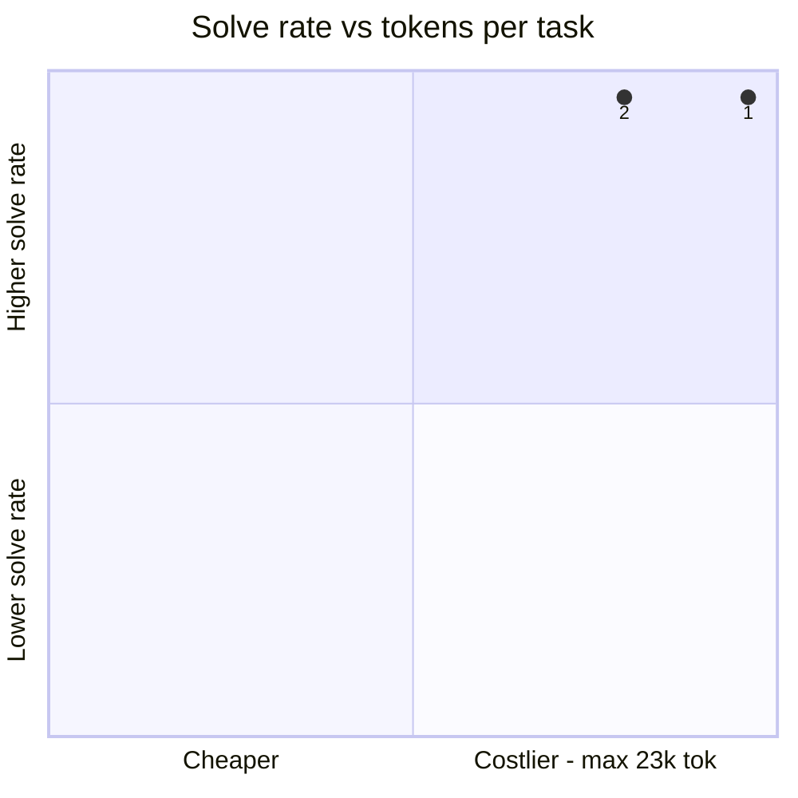
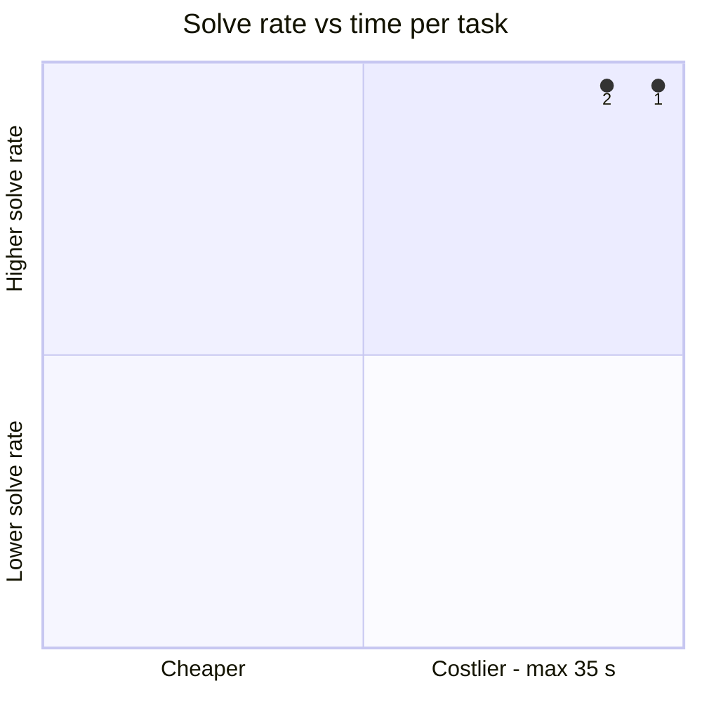
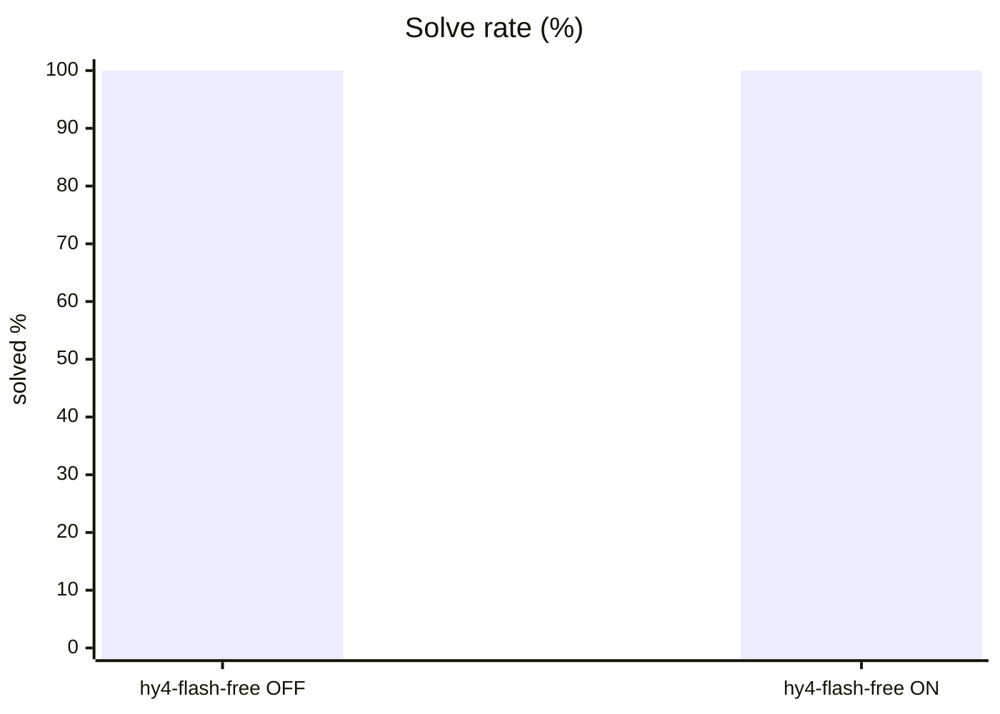
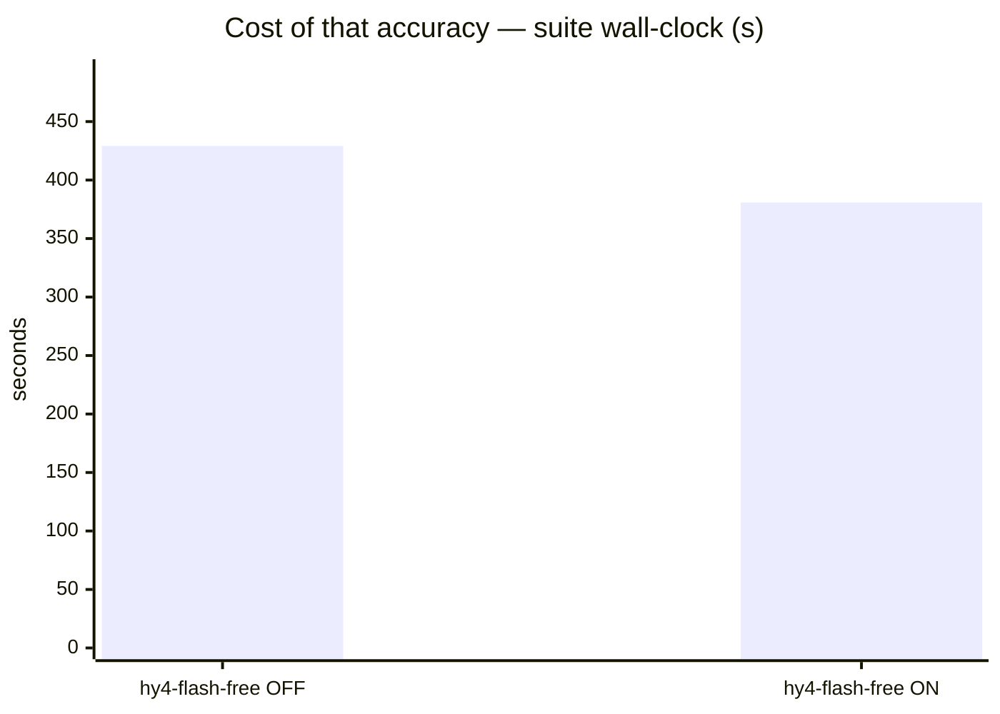
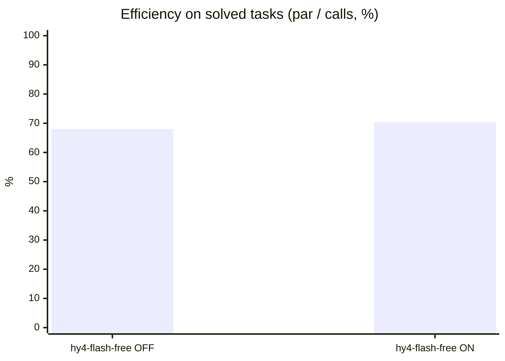
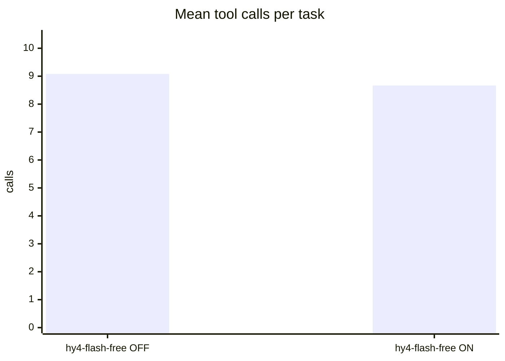
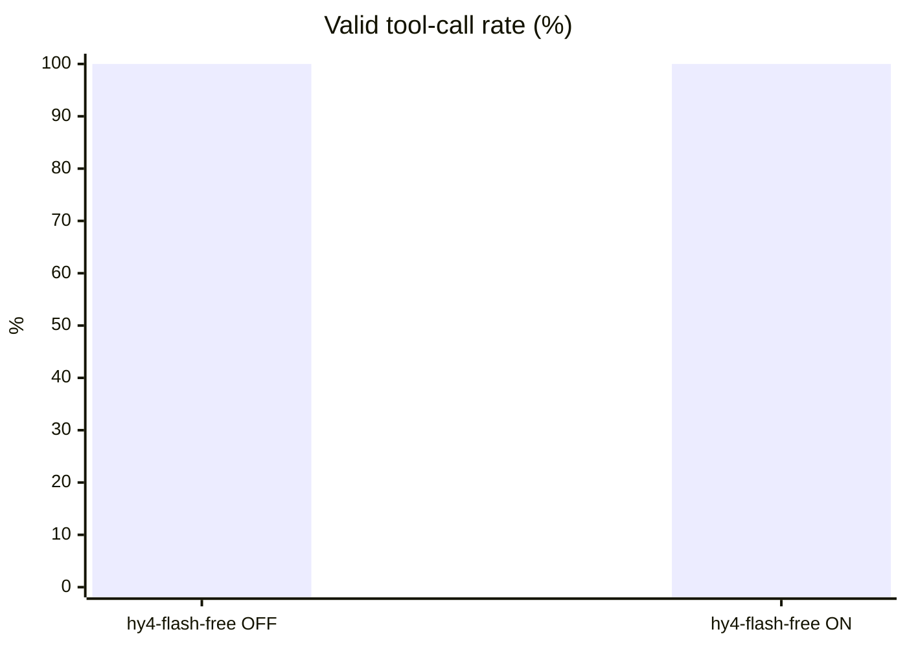

# opencode/hy4-flash-free Benchmark

**Question.** How does opencode/hy4-flash-free perform?

## Setup

| | |
|---|---|
| Endpoint | not recorded |
| Tasks | 8 |
| Samples per task | 3 (⇒ 24 generations per run) |
| Concurrency | 2 |
| Metric | solve rate (predicate over the final workspace), with a 95% Wilson interval; efficiency reported separately |

## Headline

| Run | Solve rate (95% CI) | Efficiency | Tokens per task | Time per task |
|---|---|---|---|---|
| opencode opencode-hy4-flash-free think-OFF | 100.0 % (86–100) | 68.0 % | 22,407 in / 1,074 out | 35.2 s |
| opencode opencode-hy4-flash-free think-ON | 100.0 % (86–100) | 70.3 % | 17,645 in / 965 out | 31.0 s |

<sub>The bracket is the 95% Wilson interval of the solve rate, in points. *Efficiency* = par tool calls / calls actually used, capped at 1, on solved tasks only. It is reported beside the solve rate and never multiplied into it: par comes from an oracle and harnesses count calls differently, so it measures style as much as skill. *Tokens* and *time* are the mean per task attempt (input and output tokens as the endpoint or harness reported them; wall-clock seconds).</sub>

## At a glance

| # | Run | Harness · thinking | Solve rate | Efficiency | Tokens / task | Time / task |
|---|---|---|---|---|---|---|
| 1 | opencode opencode-hy4-flash-free think-OFF | opencode · OFF | `██████████` 100 % <sub>(86–100)</sub> | `██████▊░░░` 68 % | `██████████` 23k | `██████████` 35 s |
| 2 | opencode opencode-hy4-flash-free think-ON | opencode · ON | `██████████` 100 % <sub>(86–100)</sub> | `███████░░░` 70 % | `███████▉░░` 19k | `████████▊░` 31 s |

<sub>Solve-rate bars run 0–100 %, bracket = 95% interval. Token and time bars are scaled to the costliest row — shorter is cheaper. Rows are sorted only **within** one harness and thinking mode; bars from different groups are side by side, not ranked.</sub>





<sub>Points are the `#` column above. Up is better, left is cheaper: the top-left corner is the most solved for the least spent. Cost is scaled to the costliest run.</sub>

## Results

| Run | Solved | Efficiency | easy | medium | hard | Mean turns | Mean calls | Par | Valid calls | Turn-limit | Wall | Agent score |
|---|---|---|---|---|---|---|---|---|---|---|---|---|
| opencode opencode-hy4-flash-free think-OFF | 100.0 % | 68.0 % | — | — | 100.0 % | 6.7 | 9.1 | 5.9 | 100.0 % | 0 | 429 s | 68.0 |
| **opencode opencode-hy4-flash-free think-ON** | **100.0 %** | 70.3 % | — | — | 100.0 % | 6.3 | 8.7 | 5.9 | 100.0 % | 0 | 381 s | 70.3 |

<sub>*Solved* ranks the runs; *Efficiency* is reported beside it and only breaks exact ties. *Par* is measured by running each task's oracle, so it does not depend on the model. *Valid calls* = calls that did not error. *Turn-limit* = runs abandoned without finishing. *Agent score* = solved x efficiency, out of 100 — kept for comparison with earlier reports; it no longer ranks.</sub>





```mermaid
xychart-beta
    title "Cost of that accuracy — tokens per task (in + out)"
    x-axis ["hy4-flash-free OFF", "hy4-flash-free ON"]
    y-axis "tokens" 0 --> 2.7e+04
    bar [2.348e+04, 1.861e+04]
```







## By difficulty

| Run | easy | medium | hard |
|---|---|---|---|
| opencode opencode-hy4-flash-free think-OFF | — | — | `████████` 100 % |
| opencode opencode-hy4-flash-free think-ON | — | — | `████████` 100 % |

## Task by task

<sub>Per-task solve rate (%). Tasks the runs disagree on are listed first, widest gap on top.</sub>

- 🟩 **every run solved** (8): `api_migration`, `cascading_failures`, `conflicting_docs`, `decoy_bug`, `generalise_migration`, `hidden_spec_compliance`, `perf_budget`, `wrong_test_not_code`

## Cost per task

<sub>Mean per attempt: input / output tokens, then wall-clock seconds. *not reported* = no usage reported for that task; *–* = the run has no cost record for it.</sub>

| Task | opencode opencode-hy4-flash-free think-OFF | opencode opencode-hy4-flash-free think-ON |
|---|---|---|
| `api_migration` | 20,373 / 826 · 21.5 s | 13,842 / 779 · 18.3 s |
| `cascading_failures` | 20,067 / 612 · 21.1 s | 14,625 / 634 · 18.4 s |
| `conflicting_docs` | 15,384 / 646 · 21.8 s | 19,701 / 726 · 30.1 s |
| `decoy_bug` | 18,857 / 618 · 21.8 s | 22,128 / 674 · 25.7 s |
| `generalise_migration` | 21,624 / 832 · 29.1 s | 20,697 / 693 · 24.2 s |
| `hidden_spec_compliance` | 26,779 / 1,362 · 49.6 s | 18,785 / 1,593 · 45.1 s |
| `perf_budget` | 34,846 / 3,013 · 93.8 s | 21,925 / 1,918 · 63.0 s |
| `wrong_test_not_code` | 21,327 / 682 · 22.5 s | 9,454 / 703 · 23.0 s |

## Caveats

- 3 samples per task. Every solve rate carries a 95% Wilson interval over the generations behind it, and a margin between two runs is only a result when the 95% Newcombe interval of the difference excludes zero. The intervals treat each generation as independent; samples of one task are correlated, so with few tasks the true uncertainty is if anything wider. Raise `--samples` before calling a close race.
- Multi-turn agentic tool use against a sandboxed workspace. One-shot code generation is not exercised here.
- Success is decided by a predicate over the final workspace, never by what the model claims. Every task's oracle is verified to solve it first.
- A task abandoned at the turn limit counts as failed; raise `--max-turns` before concluding the model cannot do it.

## Raw data

- `opencode-opencode-hy4-flash-free-think-off.json` — opencode opencode-hy4-flash-free think-OFF
- `opencode-opencode-hy4-flash-free-think-on.json` — opencode opencode-hy4-flash-free think-ON
